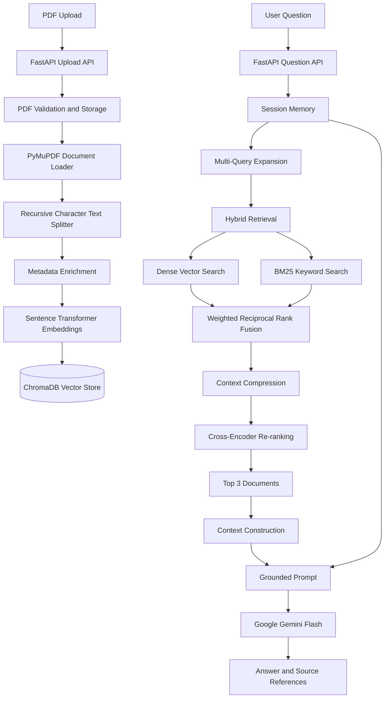

# Advanced RAG Architecture

## Enterprise RAG Platform

An AI-powered document question-answering system built using FastAPI, LangChain, ChromaDB, Sentence Transformers, and Google Gemini.

The platform allows users to upload PDF documents, retrieve relevant information using advanced retrieval techniques, and generate context-aware answers with source references.

---

## 1. System Architecture

The platform follows a modular Retrieval-Augmented Generation (RAG) architecture.

### High-Level Workflow



---

## 2. Document Ingestion Pipeline

The ingestion pipeline transforms uploaded PDF documents into searchable document chunks.

### Processing Steps

1. **PDF Upload:** FastAPI receives a PDF through the `/upload` endpoint.
2. **Validation:** The upload service validates the filename and PDF extension and prevents duplicate filenames.
3. **PDF Loading:** PyMuPDFLoader extracts page content and metadata.
4. **Text Splitting:** RecursiveCharacterTextSplitter divides documents into smaller chunks.
5. **Metadata Enrichment:** Each chunk receives additional document information.
6. **Vector Storage:** Hugging Face embeddings are generated by ChromaDB and stored in the persistent vector database.

### Text Chunking Configuration

| Parameter | Value |
|---|---|
| Chunk size | 500 characters |
| Chunk overlap | 100 characters |
| Splitting method | Recursive Character Text Splitter |
| Length function | Python string length |

### Chunk Metadata

Each chunk contains metadata such as:

- Source document path
- Filename
- Document type
- Chunk number
- Unique chunk ID
- Upload timestamp
- Page number

### Embedding Model

**Model:** `sentence-transformers/all-MiniLM-L6-v2`

The embedding model converts document chunks into numerical vectors representing their semantic meaning.

These vectors are stored in ChromaDB for semantic similarity search.

### Vector Database

**Technology:** ChromaDB

**Persistence directory:** `chroma_storage`

The database supports:

- Adding document chunks
- Semantic similarity search
- Retrieving indexed documents
- Listing documents and their chunk counts
- Deleting document chunks

---

## 3. Advanced Retrieval Pipeline

The retrieval system combines multiple retrieval techniques to improve the relevance of the information supplied to the language model.

### Stage 1: Multi-Query Expansion

**Implementation:** `multi_query_retriever.py`

The system generates four search variations from the original question:

1. Original user question
2. An explanation-oriented query
3. A key-concepts query
4. A technical-details query

Query expansion is performed locally without requiring an additional LLM call.

This increases the chances of finding relevant information expressed using different terminology.

### Stage 2: Hybrid Search

**Implementation:** `hybrid_retriever.py`

Hybrid retrieval combines two complementary search methods.

**A. Dense Vector Search**

- Uses ChromaDB.
- Finds semantically similar document chunks.
- Can retrieve relevant information even when the exact keywords differ.

**B. BM25 Keyword Search**

- Uses the `rank_bm25` library.
- Tokenizes text using lowercase word extraction.
- Matches important query terms against indexed document chunks.
- Provides keyword-based relevance scores.

**C. Weighted Reciprocal Rank Fusion**

The rankings from dense retrieval and BM25 are combined using weighted Reciprocal Rank Fusion.

Configuration:

| Parameter | Value |
|---|---:|
| Dense retrieval weight | 0.7 |
| BM25 retrieval weight | 0.3 |
| RRF constant | 60 |
| Initial retrieval top-k | 5 |

The fusion formula is:

\[
RRF(d)=\sum_{r \in R}
\frac{w_r}{60+\operatorname{rank}_r(d)}
\]

Where:

- \(d\) represents a document.
- \(R\) represents the retrieval systems.
- \(w_r\) represents the weight assigned to each retrieval system.
- \(\operatorname{rank}_r(d)\) represents the document's rank in that system.

The fused ranking combines semantic and keyword relevance.

### Stage 3: Duplicate Removal

**Implementation:** `multi_query_retriever.py`

Results from different query variations are combined.

The system normalizes document content by converting it to lowercase and removing repeated whitespace.

Documents with identical normalized content are merged to reduce duplicate retrieval results.

The final multi-query ranking uses reciprocal-rank contributions from the individual searches.

### Stage 4: Context Compression

**Implementation:** `compressor.py`

The retrieved documents are evaluated using cosine similarity between the question embedding and each document embedding.

Cosine similarity:

\[
\operatorname{Similarity}(A,B)=
\frac{A\cdot B}{\|A\|\|B\|}
\]

Configuration:

| Parameter | Value |
|---|---:|
| Minimum similarity threshold | 0.35 |
| Maximum compressed documents | 3 |

Documents below the configured threshold are filtered out.

If no documents meet the threshold, the system retains the highest-scoring candidates as a fallback.

### Stage 5: Cross-Encoder Re-ranking

**Implementation:** `reranker.py`

The compressed documents are passed through a Cross-Encoder model.

**Model:** `cross-encoder/ms-marco-MiniLM-L-6-v2`

Unlike independent embedding similarity, the Cross-Encoder evaluates each question-document pair directly.

It calculates relevance scores, sorts the documents, and returns the highest-ranked results.

**Final output:** Up to 3 documents.

---

## 4. Answer Generation Pipeline

**Implementation:** `rag_chain.py`

After retrieval and re-ranking, the final documents are converted into context for the language model.

### Context Construction

The system builds a context containing:

- Source filename
- Page number
- Retrieved document content

### Grounded Prompting

The prompt instructs the language model to:

- Answer using the supplied document context.
- Use conversation history to understand follow-up questions.
- Avoid inventing unsupported facts.
- Explain when the documents contain incomplete information.
- Return a fallback response when no relevant information is available.

### Language Model

**Provider:** Google Gemini

**Model:** `gemini-flash-latest`

Configuration:

| Parameter | Value |
|---|---|
| Temperature | 0 |
| Integration | LangChain Google Generative AI |
| Response modes | Standard and streaming |

The platform supports:

- Complete answer generation using `llm.invoke()`.
- Incremental answer generation using `llm.stream()`.

---

## 5. Conversational Memory

**Implementation:** `conversation_memory.py`

The platform supports session-based conversational memory.

Features:

- Separate conversation history for each session ID.
- Stores user questions and assistant answers.
- Retains the latest five conversation turns per session.
- Supports clearing individual sessions or all sessions.
- Uses a thread lock when accessing the session manager.

Conversation history helps the system understand follow-up questions while document content remains the authoritative source for factual answers.

**Storage note:** Conversation memory is currently maintained in application memory and is not persistent across application restarts.

---

## 6. REST API Endpoints

The backend is implemented using FastAPI.

| HTTP Method | Endpoint | Description |
|---|---|---|
| GET | `/` | Check API availability |
| POST | `/upload` | Upload and index a PDF |
| POST | `/ask` | Generate a document-grounded answer |
| POST | `/ask/stream` | Stream an answer incrementally |
| GET | `/documents` | List indexed documents |
| DELETE | `/documents/{filename}` | Delete a document and its indexed chunks |

### Question Request

The question endpoints accept:

```json
{
  "question": "What are the technical skills mentioned in this document?",
  "session_id": "session_001"
}
```

### Standard Answer Response

The `/ask` endpoint returns:

```json
{
  "question": "What are the technical skills mentioned in this document?",
  "answer": "The answer generated from the retrieved document context.",
  "sources": [
    {
      "filename": "resume.pdf",
      "page": 0
    }
  ]
}
```

The `/ask/stream` endpoint returns a streaming text response.

---

## 7. Technology Stack

| Category | Technologies |
|---|---|
| Programming Language | Python |
| Backend Framework | FastAPI |
| RAG Framework | LangChain |
| PDF Processing | PyMuPDF |
| Text Splitting | RecursiveCharacterTextSplitter |
| Embedding Model | Sentence Transformers |
| Vector Database | ChromaDB |
| Keyword Retrieval | BM25 / rank_bm25 |
| Hybrid Retrieval | Weighted Reciprocal Rank Fusion |
| Context Compression | Cosine Similarity |
| Re-ranking | Cross-Encoder |
| Language Model | Google Gemini Flash |
| API Validation | Pydantic |
| Testing | Pytest |
| Version Control | Git and GitHub |

---

## 8. Project Structure

```text
enterprise-rag-platform/
│
├── backend/
│   ├── app/
│   │   ├── api/
│   │   │   ├── main.py
│   │   │   └── upload.py
│   │   │
│   │   ├── loaders/
│   │   │   ├── pdf_loader.py
│   │   │   └── multi_pdf_loader.py
│   │   │
│   │   ├── preprocessing/
│   │   │   └── text_splitter.py
│   │   │
│   │   ├── embeddings/
│   │   │   └── embedding_generator.py
│   │   │
│   │   ├── vectordb/
│   │   │   └── chroma_db.py
│   │   │
│   │   ├── retriever/
│   │   │   ├── bm25_retriever.py
│   │   │   ├── hybrid_retriever.py
│   │   │   ├── multi_query_retriever.py
│   │   │   └── retriever.py
│   │   │
│   │   ├── context_compressor/
│   │   │   └── compressor.py
│   │   │
│   │   ├── reranker/
│   │   │   └── reranker.py
│   │   │
│   │   ├── rag/
│   │   │   └── rag_chain.py
│   │   │
│   │   ├── llm/
│   │   │   └── gemini_llm.py
│   │   │
│   │   ├── memory/
│   │   │   └── conversation_memory.py
│   │   │
│   │   ├── pipelines/
│   │   │   └── ingestion_pipeline.py
│   │   │
│   │   ├── uploader/
│   │   │   └── upload_service.py
│   │   │
│   │   ├── models/
│   │   │   └── response_models.py
│   │   │
│   │   └── utils/
│   │       └── logger.py
│   │
│   └── tests/
│       ├── test_retriever.py
│       └── test_compressor.py
│
└── docs/
    └── ADVANCED_RAG_ARCHITECTURE.md
```

---

## 9. Automated Testing

The project includes automated unit tests using Pytest.

### Retrieval Tests

The retrieval test suite validates:

- Multi-query generation.
- Empty query handling.
- Text normalization.
- Duplicate document removal.
- Empty-search behavior.

### Compression Tests

The compression test suite validates:

- Cosine similarity for identical vectors.
- Cosine similarity for orthogonal vectors.
- Zero-vector handling.
- Empty document handling.
- Relevant document ranking.
- Fallback behavior when no document meets the similarity threshold.

### Run Tests

From the backend directory:

```bash
python -m pytest -v
```

**Latest verified result: 11 tests passed.**

---

## 10. Key Features

- PDF document ingestion and indexing.
- Semantic vector retrieval.
- BM25 keyword retrieval.
- Weighted hybrid search.
- Local multi-query expansion.
- Duplicate document removal.
- Semantic context compression.
- Cross-Encoder re-ranking.
- Grounded Gemini answer generation.
- Streaming responses.
- Session-based conversational memory.
- Document listing and deletion APIs.
- Automated retrieval and compression tests.

---

## Conclusion

The Enterprise RAG Platform combines semantic search, keyword retrieval, multi-query expansion, context compression, and Cross-Encoder re-ranking to improve document retrieval quality.

Its modular architecture separates document ingestion, retrieval, answer generation, memory, and API functionality, making the system easier to test, maintain, and extend.
